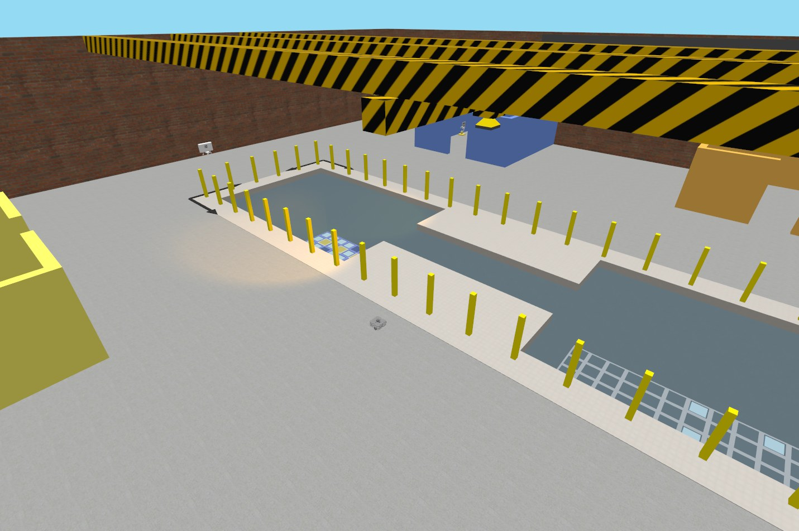
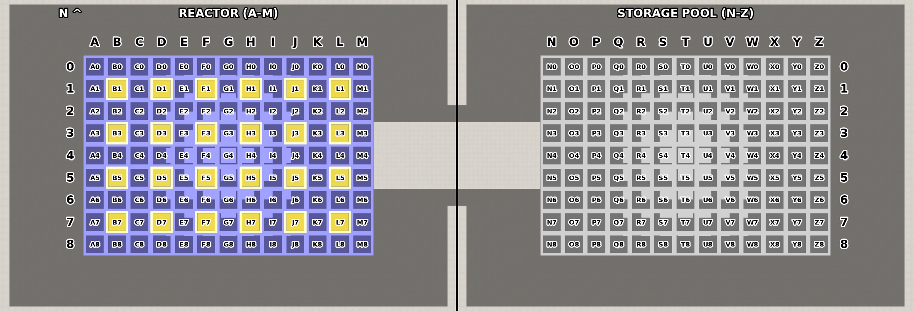

AURO'2026 Assessment ROS2 Package
---------------------------------
This package contains the simulation environment for the AURO assessment: a facility with
a reactor, a storage pool and an overhead crane, and a TurtleBot3 Waffle Pi. There are two tasks,
selected with the launch argument `task`: in `task1` the robot fetches an end effector for the
crane, and in `task2` the crane manages the reactor's rods.

Note that for the assessment you are **not allowed** to change the ROS implementation of the
simulation environment, nor any files within the packages `assessment`, `assessment_interfaces` or
`auro_gz_plugins`.

Your solution should be developed primarily within the `solution` package, but you **may create
any additional ROS2 packages** if deemed necessary for your solution. New messages and services can
be added to the package `solution_interfaces` (see its [README](../solution_interfaces/README.md)).
Moreover, the `solution.launch.py` launch file **must support all existing parameters**, but you can
add additional parameters.

Your solution must interact with the simulation **only through ROS**, in both tasks: it must not
use Gazebo's transport (gz-transport), whether directly, through `ros_gz_bridge` or other bridges,
or through the `gz` command line.

The parameters used to run your solution to task1 and the scenarios for task2 should be defined in a `devcontainer.json` file, as indicated in the assessment
brief, with parameters used to launch `solution.launch.py`. The tool `check.py`, at the root of the
workspace, can be used to help you check that your workspace is configured correctly, and, among
other commands, to zip the workspace ready for submission.

**Note:** While you are free to use any of the provided .devcontainer configurations (e.g. auro-vnc,
auro-wsl, or auro-linux-auto) for development, the dependencies and scenarios of your solution (the
`auro` customizations, see below) must be in the root `devcontainer.json` file, and it is your
responsibility to ensure that, for submission, that configuration executes properly.

A screenshot of a simulation of task2, launched using the default parameters, is reproduced below:
the reactor hall, with the crane above the reactor (left) and the storage pool (right), and the
TurtleBot3 on the floor.



# Tasks
Your implementation task, as described in the assessment paper, is to design and implement
autonomous robotic systems, running in simulation, for the two tasks below. Both run in the same
world.

## Task 1: fetching an end effector
The TurtleBot3 has to find a specific **end effector** among those spread around the arena, pick it up, and deliver it to the **platform marked with a white X**, east of the pool.

There are a total of 16 end effectors. Each stands on the floor next to an
**ArUco tag** from OpenCV's `DICT_4X4_50` dictionary:

The position of end effectors and their tags can swap place at random on every launch 
(see the launch argument `random_seed`). Which one is the target is
a setting of the simulation (`target_end_effector`, see below): by default the `suction_cup`.

### Picking up and offloading end effectors
An end effector can be picked up when the robot is close enough to it, by calling the ROS service
`/pickup`: the robot then carries it, above itself, until it calls `/offload`, which puts it down
on the floor. End effectors can be offloaded anywhere, and picked up again. Details of these ROS
facilities are discussed further below.

### Delivering the end effector
The delivery counts when the target end effector is offloaded on the platform
marked with the X. The topic `/collected` then turns `true`, for good.

## Task 2: managing the reactor
The overhead crane can move rods between the reactor and the storage pool.

The reactor (cell columns A to M) holds **fuel rods**, each with its own power level, and
**control rods**. The storage pool (columns N to Z) holds a few **replacement rods**. The current power level of the reactor is published on `/current_power_level`. The target power level
is published on `/target_power_level`. Both are shown on the north wall in the Gazebo GUI.

How full the reactor is, the levels of its rods and which storage cells hold replacement rods are
random on every launch (see the launch argument `random_seed`).

### Cell map

The service `/cell_pose` takes the index of a cell and returns the coordinates of the cell.
The cells are indexed by a column letter, west to east (A to M in the reactor, N to Z in the storage
pool), and a row number, north to south (0 to 8). The map below shows them from above, with north at the top.



The map is generated from the world by [scripts/cell_map.py](scripts/cell_map.py), with the
workspace built and sourced.

### Operating the crane
The crane has three joints which the solution drives by **effort** (force), with
its own controllers, through ros2_control:

* `bridge_slide`: moves the bridge along x;
* `winch_block_slide`: moves the trolley, under the bridge, along y;
* `winch_lift`: raises and lowers the winch.

The winch has a **brake**, which holds it whatever the effort applied. It can be controlled via the ROS services `/crane/winch/brake/release` and `/crane/winch/brake/engage`, as further described below.

The winch grabs the rod directly below it with `/crane/winch/attach`, and lets go of it with
`/crane/winch/detach`. The winch has a camera looking down.

# Simulation environment
The robot is spawned in both tasks at a fixed pose. Everything runs on simulation time.

## Simulation environment nodes
The functionality of the ROS nodes provided as part of the simulation environment and their ROS
interfaces are described in detail below.

### simulation_monitor (both tasks)
This node tells other nodes when the simulation is ready to be used. It publishes the topic:

* `/simulation_ready`: of type [`std_msgs/Bool`](https://docs.ros.org/en/rolling/p/std_msgs/msg/Bool.html), `false` until everything the task needs is up, and then becomes `true`. It is latched, so that subscribers with transient local durability can get the current value at any time.

### The mobile robot (task1)
The TurtleBot3 Waffle Pi's interfaces are bridged from Gazebo by `ros_gz_bridge`:

* `/cmd_vel`: of type [`geometry_msgs/TwistStamped`](https://docs.ros.org/en/rolling/p/geometry_msgs/msg/TwistStamped.html), the velocity command.
* `/odom`: of type [`nav_msgs/Odometry`](https://docs.ros.org/en/rolling/p/nav_msgs/msg/Odometry.html).
* `/scan`: of type [`sensor_msgs/LaserScan`](https://docs.ros.org/en/rolling/p/sensor_msgs/msg/LaserScan.html), the lidar.
* `/imu`: of type [`sensor_msgs/Imu`](https://docs.ros.org/en/rolling/p/sensor_msgs/msg/Imu.html).
* `/camera/image_raw`: of type [`sensor_msgs/Image`](https://docs.ros.org/en/rolling/p/sensor_msgs/msg/Image.html), the RGB camera's images.
* `/joint_states`: of type [`sensor_msgs/JointState`](https://docs.ros.org/en/rolling/p/sensor_msgs/msg/JointState.html), the wheels', which `robot_state_publisher`
  turns into the robot's TF frames.
* `/clock`: of type [`rosgraph_msgs/Clock`](https://docs.ros.org/en/rolling/p/rosgraph_msgs/msg/Clock.html), simulation time.

The robot's description is published on `/robot_description`, of type [`std_msgs/String`](https://docs.ros.org/en/rolling/p/std_msgs/msg/String.html).

### end_effector_manager (task1)
This node lets the robot pick up the end effectors and offload them. It serves the ROS services:

* `/pickup`: of type [`std_srvs/Trigger`](https://docs.ros.org/en/rolling/p/std_srvs/srv/Trigger.html), picks up the nearest end effector.
* `/offload`: of type [`std_srvs/Trigger`](https://docs.ros.org/en/rolling/p/std_srvs/srv/Trigger.html), puts down the end effector the robot carries on the floor.

It also publishes the topic:

* `/collected`: of type [`std_msgs/Bool`](https://docs.ros.org/en/rolling/p/std_msgs/msg/Bool.html), latched, `false` until the target end effector is successfully offloaded on the platform, at which
point `true` is published.

This node, and the end effectors themselves, can be left out by changing the launch argument
`end_effectors`.

### Nav2 (task1)
[Nav2](https://docs.nav2.org/) is available in task1, with the launch argument `nav2`: either in SLAM mode as `slam`, or for localising on a map you provide (with AMCL). All its nodes are under one lifecycle manager, `/lifecycle_manager_navigation`. 

By default `nav2_start` is set to `auto`, so the node `nav2_startup` starts them once the simulation is
ready; with `manual`, your solution must start them itself, e.g. as
[nav2_startup.py](assessment/nav2_startup.py) does, or with nav2_simple_commander's
`BasicNavigator.lifecycleStartup()`.

Nav2 is configured by [config/nav2_params.yaml](config/nav2_params.yaml), which you can replace
with the launch argument `nav2_params`, and can keep out of areas marked on a mask
(`keepout_mask`).

### reactor_monitor (task2)
This node keeps track of the rods, and of the reactor's power level. It publishes the topics:

* `/current_power_level`: of type [`std_msgs/Float64`](https://docs.ros.org/en/rolling/p/std_msgs/msg/Float64.html) the reactor's power level as a
  percentage of the maximum power level (see Task 2 above).
* `/target_power_level`: of type [`std_msgs/Float64`](https://docs.ros.org/en/rolling/p/std_msgs/msg/Float64.html), the target, also a percentage of the maximum.

It also offers the ROS services:

* `/cell_pose`: of type [`CellPose`](../assessment_interfaces/srv/CellPose.srv), the centre of a
  cell's top opening, in the world frame, by its index: a column letter, west to east (A to M in the
  reactor, N to Z in the storage pool), and a row number, north to south, e.g. `C4`.
* `/crane/winch/rod_power_level`: of type
  [`RodPowerLevel`](../assessment_interfaces/srv/RodPowerLevel.srv), the power level of the fuel rod
  directly below the winch, if the winch is close enough above it.

### power_display (task2)
This node draws the current and target power levels, and a gauge, on the north wall in the Gazebo
GUI. It can be turned off with the launch argument `power_display`, and is not run when Gazebo is
`headless`.

### The crane (task2)
The crane's joints are under ros2_control, run by Gazebo (gz_ros2_control), with a controller
manager `/crane/controller_manager` and the controller `effort_controller`, of type
`forward_command_controller/ForwardCommandController`, configured in
[config/crane_controllers.yaml](config/crane_controllers.yaml):

* `/crane/effort_controller/commands`: of type [`std_msgs/Float64MultiArray`](https://docs.ros.org/en/rolling/p/std_msgs/msg/Float64MultiArray.html), the efforts to apply,
  in newtons, to `bridge_slide`, `winch_block_slide` and `winch_lift`, in that order. Each is held to its joint's limit (`crane_effort_limits`), and a joint's effort is cut when it reaches its speed limit.
* `/crane/joint_states`: of type [`sensor_msgs/JointState`](https://docs.ros.org/en/rolling/p/sensor_msgs/msg/JointState.html), the state of the crane's joints.

The winch's services, bridged from Gazebo, all of type [`ros_gz_interfaces/ControlWorld`](https://docs.ros.org/en/rolling/p/ros_gz_interfaces/srv/ControlWorld.html), whose
request parameters are ignored and whose response's `success` says whether it worked:

* `/crane/winch/attach`: grabs the rod directly below the winch. It can also fail with probability
  `winch_failure_probability`.
* `/crane/winch/detach`: lets go of what the winch holds. Can also fail at random.
* `/crane/winch/brake/release` and `/crane/winch/brake/engage`: take the winch's brake off, or put
  it on, holding the winch where it is. The brake is on from the start.

The winch camera, looking down from the winch:

* `/crane/winch_camera/image`: of type [`sensor_msgs/Image`](https://docs.ros.org/en/rolling/p/sensor_msgs/msg/Image.html). Its frame rate and noise are set with
  the launch arguments `winch_camera_rate` and `winch_camera_noise`.
* `/crane/winch_camera/camera_info`: of type [`sensor_msgs/CameraInfo`](https://docs.ros.org/en/rolling/p/sensor_msgs/msg/CameraInfo.html).

The crane's TF frames are published by a `robot_state_publisher` in the namespace `crane`, from
`/crane/joint_states`: `crane/crane_base` (at the world's origin), `crane/rail_*`, `crane/bridge`,
`crane/winch_block`, `crane/winch` and the camera's `crane/winch_camera_optical`. Its description
is published on `/crane/robot_description`, of type [`std_msgs/String`](https://docs.ros.org/en/rolling/p/std_msgs/msg/String.html).

## Launch files (solution.launch.py)
The solution is launched with [solution.launch.py](../solution/launch/solution.launch.py), which
includes `assessment.launch.py` and starts the solution's node for the task. You are encouraged to
check in detail the arguments it supports, e.g. by running
`ros2 launch solution solution.launch.py --show-args`. Arguments are given as `name:=value`, e.g.
`ros2 launch solution solution.launch.py task:=task1 nav2:=slam`. In `solution.launch.py`, an
argument with an empty value is not set: `assessment.launch.py`'s default applies.

Arguments expecting a file should be given as `package://<package>/<path>`, which keeps working when
the workspace moves (install them in the package's `setup.py`).

The following arguments apply to both tasks:

* `task` : The task to run: `task1` or `task2` (default: `task2`).
* `random_seed` : Random number seed for the layout of the world: the end effectors in task1, the fuel rods and their levels in task2, and the winch's
  failures. Empty, the default: random, and logged.
* `time_limit` : The simulation time, in seconds, after which the simulation ends, counted from
  when `/simulation_ready` turns true: the whole launch shuts down. In `solution.launch.py`, the default is `300` (5 minutes) in task1 and `900`
  (15 minutes) in task2.

The following arguments apply to task1:

* `nav2` : Whether to use the [ROS2 Nav2 stack](https://docs.nav2.org/): `false` (default),
  `slam`, to build a map as the robot moves, or a map's YAML file, to localise on it with AMCL.
* `nav2_start` : With Nav2, `auto` (default): the launch starts Nav2 once the simulation is ready;
  `manual`: your solution starts it.
* `nav2_params` : Nav2 parameters file, to use instead of
  [config/nav2_params.yaml](config/nav2_params.yaml). Empty, the default: that file.
* `keepout_mask` : With Nav2, the YAML file of a mask (as a map) of areas Nav2 must keep out of.
  Empty, the default: none.
* `end_effectors` : Whether the end effectors, and their ArUco tags, are in the world, and
  `end_effector_manager` runs (default: `true`).

The following arguments apply to task2:

* `target_power_level` : The target power level, in % of the maximum power level (default: `50`).
* `maximum_power_level` : The power level that counts as 100%, as a sum of rod levels. Empty, the
  default: a full reactor with all control rods in, i.e. 100 × the number of reactor fuel cells.
* `control_rod_coefficient` : The power increase per control rod removed from the reactor
  (default: `0.20`, i.e. +20%).
* `reactor_fill_percentage` : The share of the reactor's fuel cells that hold a rod, in %
  (default: `80`).
* `initial_mean_level` : The mean power level of the rods in the reactor, in % (default: `50`).
* `initial_level_distribution` : How the reactor rods' levels are distributed: `uniform` (default)
  or `normal`.
* `initial_level_spread` : The half-width (uniform) or standard deviation (normal) of the reactor
  rods' levels, in percentage points (default: `25`).
* `replacement_percentage` : The share of the storage cells that hold a replacement rod, in %
  (default: `20`).
* `replacement_level` : The power level of the replacement rods: a percentage, `all_full` (100%)
  or `half_full` (50%) (default: `100`).
* `winch_failure_probability` : The chance (0 to 1) that a valid winch attach or detach fails
  (default: `0`).
* `winch_camera_rate` : The winch camera's frame rate, in Hz (default: `10`).
* `winch_camera_noise` : The standard deviation of Gaussian pixel noise on the winch camera,
  relative to the full pixel range, e.g. `0.01` (default: `0`, no noise).
* `power_display` : Whether to show the power levels on the north wall in the Gazebo GUI
  (default: `true`).
* `winch_cable` : Whether to show the cable from the winch block to the winch in the Gazebo GUI
  (default: `true`).

The simulation may be executed headless and faster than real-time, and with less output, by
controlling the following parameters:

* `headless` : Whether to run without the Gazebo GUI (default: `false`). The server still renders
  the cameras and the lidar through the X display.
* `headless_rendering` : Whether the Gazebo server renders the cameras and the lidar with EGL,
  directly on the GPU, with no X display needed, e.g. over SSH (default: `false`). The user needs
  access to the GPU's render device (`/dev/dri/renderD*`).
* `limit_real_time_factor` : Whether to limit the Gazebo real-time factor to 1.0 (default:
  `true`). If this is set to false, then a simulation can be executed faster than real-time, if
  the machine can keep up.
* `gazebo_verbose` : The verbosity of Gazebo's output: `0` none, `1` errors, `2` warnings
  (default), `3` information, `4` debug.

RViz2 can show the robot (task1) or the crane and the winch camera (task2):

* `rviz` : Whether to launch RViz2 (default: `false`).
* `rviz_config_file` : The RViz configuration file. Empty, the default: the assessment's own for
  the task, [rviz/task1.rviz](rviz/task1.rviz) or [rviz/crane.rviz](rviz/crane.rviz).
* `rviz_log_level` : The level of messages RViz prints on the command line: `debug`, `info`
  (default), `warn`, `error` or `fatal`.

ROS stamps log messages with wall time, even on simulation time. To see when things happened in
the simulation:

* `sim_time_log` : Whether to also print every node's log messages (from `/rosout`) stamped with
  simulation time, by the node `sim_time_log` (default: `false`). Each line shows the simulation
  time when the message arrived, and the wall time it was logged at, e.g.
  `[sim    37.870] [wall 23:59:38.722] [INFO] [node]: output`.
* `sim_time_log_file` : With `sim_time_log`, a file to write those lines to, instead of the
  terminal. Empty, the default: the terminal.

Only one simulation can run at a time: the launch fails, saying so, if Gazebo is already running.

## Sample solution schema
A minimal code schema for a potential solution is included in the package
[`solution`](../solution/): [task1.py](../solution/solution/task1.py) and
[task2.py](../solution/solution/task2.py), which wait for the simulation to be ready. Your solution must be launched using the
[`solution.launch.py`](../solution/launch/solution.launch.py) file. That file reuses the launch
file `assessment.launch.py`, that launches the simulation environment. For your submission,
[`solution.launch.py`](../solution/launch/solution.launch.py) must support all existing
parameters, but you may add new parameters (to its table `NODE_ARGUMENTS`, for your nodes, or, for example, using ROS2's Launch API) and
change the solution launch file as deemed necessary to implement your solution.

### Scenarios
Scenarios for exercising your solution should be specified in the `devcontainer.json` file (by
default [.devcontainer/devcontainer.json](../.devcontainer/devcontainer.json)), following the
structure outlined below. A scenario without a `task` parameter is of `task2`.

```
{
    ...
    "customizations": {
        "auro": {
            // "apt" : [ "some-apt-package" ],
            // "pip" : [ "some-pip-package" ],
            "scenarios" : [
                {
                    "name": "Task 1, SLAM",
                    "description": "Nav2 building a map as the robot moves",
                    "parameters": {
                        "task": "task1",
                        "nav2": "slam"
                    }
                },
                {
                    "name": "Task 2, unreliable winch",
                    "description": "A fifth of attaches and detaches fail, and the winch camera is noisy",
                    "parameters": {
                        "random_seed": 7,
                        "winch_failure_probability": 0.2,
                        "winch_camera_noise": 0.01
                    }
                }
            ]
        }
    }
}
```

## Additional apt and pip packages
Additional apt and pip packages, if needed, should be specified in the same `devcontainer.json`
file, following the structure outlined above. They can be automatically installed using the
command `./check.py install-dependencies`, which is how additional packages will be installed,
upon evaluating your submitted solution.

## check.py - Checking your ROS2 workspace before submission!
You are encouraged to make use of the utility [check.py](../check.py) to help with checking that
your submission is consistent and reproducible. The utility can help with building a workspace,
cleaning it, installing dependencies specified in the `devcontainer.json` file, as well as, list
scenarios (e.g. `./check.py list-scenarios --task task2`), execute them (e.g.
`./check.py run-scenario 2`), and package the workspace as a ZIP file. Run it with the workspace
built and sourced (`source install/setup.bash`).

Of particular importance is the subcommand `check-submission`, which checks that:

* only one `devcontainer.json` file has `auro` customizations;
* `solution.launch.py` supports every argument of `assessment.launch.py`;
* the launch arguments of your solution are valid, as `assessment.launch.py` would check them:
  for each task with the defaults of `solution.launch.py` (e.g. in task1, that `nav2`,
  `nav2_start` and `keepout_mask` make sense together, and that a map exists, if any is specified), 
  and for every scenario;
* your solution's packages (`solution`, and the packages of the workspace it depends on) do not
  use Gazebo's transport;
* the packages `assessment`, `assessment_interfaces` and `auro_gz_plugins` are unchanged with
  respect to the AURO2026 repository's main branch.

Further details are available using its help command, as illustrated below:

```
$ ./check.py -h
usage: check.py [-h]
                {build,check-submission,install-dependencies,list-scenarios,run-scenario,check-zip,clean,list-launch,zip-workspace} ...

AURO2026 assessment workspace tool [version: 2.0]

positional arguments:
  {build,check-submission,install-dependencies,list-scenarios,run-scenario,check-zip,clean,list-launch,zip-workspace}
                        Subcommands
    build               Build a ROS 2 workspace
    check-submission    Check that a workspace is ready to be submitted
    install-dependencies
                        Install the apt and pip packages listed in
                        devcontainer.json
    list-scenarios      List the scenarios in devcontainer.json, and check
                        them
    run-scenario        Launch the solution with a scenario of
                        devcontainer.json
    check-zip           Check whether a ZIP holds a ROS 2 workspace
    clean               Remove build/, install/ and log/
    list-launch         List launch files and their arguments
    zip-workspace       Zip a workspace, without build/, install/, log/ and
                        .git/

options:
  -h, --help            show this help message and exit
```
